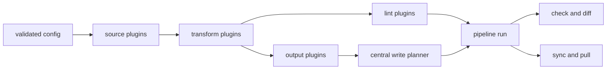

# Architecture

Farmall keeps one source of truth for AI coding-agent configuration, projects it into each agent's native layout, and checks whether the result remains portable.

## Package layout

```text
packages/
|-- cli/   # Published `farmall` executable
`-- core/  # Internal pipeline, plugin, planning, and apply engine
```

| Package         | Purpose                                                                   |
| --------------- | ------------------------------------------------------------------------- |
| `farmall`       | Maltty command registration, argument handling, rendering, and exit codes |
| `@farmall/core` | Config loading, plugins, pipeline execution, planning, and safe writes    |

Keep domain behavior in `packages/core`. Keep `packages/cli` as the process boundary.

## Module layout

| Module                            | Responsibility                                                               |
| --------------------------------- | ---------------------------------------------------------------------------- |
| `packages/cli/src/index.ts`       | Starts Maltty and registers the command map                                  |
| `packages/cli/src/commands/`      | Implements the `init`, `pull`, `sync`, `lint`, `check`, and `diff` commands  |
| `packages/cli/src/output.ts`      | Converts core values into stable text and binary-safe JSON                   |
| `packages/cli/src/exit-status.ts` | Maps core failures and command results to process status                     |
| `packages/core/src/config/`       | Discovers, loads, and validates Farmall config files                         |
| `packages/core/src/plugins/`      | Owns plugin context, loading, resolution, and runtime result schemas         |
| `packages/core/src/builtins/`     | Implements built-in sources, linting, filesystem output, and platforms       |
| `packages/core/src/pipeline/`     | Runs distinct plugin stages, severity handling, and planning                 |
| `packages/core/src/planning/`     | Computes desired filesystem actions and ownership manifests                  |
| `packages/core/src/apply/`        | Verifies, applies, and rolls back planned filesystem changes                 |
| `packages/core/src/project/`      | Owns templates, initialization, preparation, validation, and synchronization |
| `packages/core/src/result.ts`     | Defines the shared `Result<T, E>` boundary                                   |
| `packages/core/src/types.ts`      | Re-exports domain types from their owning modules                            |

## Data flow



1. Discover and validate a TypeScript, JavaScript, JSON, JSONC, or YAML config.
2. Load built-in plugins and modules listed in `config.plugins`.
3. Run configured source plugins to emit normalized artifacts or direct outputs.
4. Pass emissions through transform plugins in declaration order.
5. Run output plugins to produce desired files and lint plugins to produce diagnostics.
6. Apply configured severity overrides and sort diagnostics deterministically.
7. Build one write plan from all desired files.
8. Render the plan for `check` and `diff`, or apply it for `sync` and `pull`.

## Boundaries

### CLI

`packages/cli` owns Maltty command definitions, process arguments, terminal output, and exit codes. Command handlers call project-level core functions and use Maltty's `ctx.fail` only at the executable boundary.

### Core

`packages/core` owns the domain model and stays independent of terminal rendering. Fallible operations return `Result<T, CoreError>` for expected config, plugin, source, lint, conflict, plan, and apply failures. The CLI unwraps that result and converts errors into terminal messages and exit codes.

### Plugins

Every plugin has `apiVersion: 1`, a unique `id`, a `kind`, an optional option validator, and a `run` function. External return values are runtime-validated before they enter the pipeline. Each plugin invocation receives a deep-frozen clone of its options and, where applicable, upstream emissions. The four plugin kinds have distinct contracts:

| Kind        | Input                      | Output                        |
| ----------- | -------------------------- | ----------------------------- |
| `source`    | Options and plugin context | Artifacts and direct outputs  |
| `transform` | Current emissions          | Replaced emissions            |
| `lint`      | Transformed emissions      | Diagnostics                   |
| `output`    | Transformed emissions      | Desired files and diagnostics |

Built-in sources read Farmall's portable filesystem layout or an existing platform layout. Built-in outputs target Claude Code, Cursor, Codex, Copilot, OpenCode, Windsurf, Devin, Pi, or the portable filesystem layout. `farmall:lint` checks skill frontmatter and cross-platform field support.

### Write planner

All output plugins feed the planner in `packages/core/src/planning/create-plan.ts`. The planner normalizes paths, rejects output collisions and paths outside the project root, and compares desired files with the filesystem and `.farmall-state.json` ownership manifest.

Plan actions are `create`, `update`, `delete`, `noop`, or `conflict`. Managed files can be updated or removed only when their recorded digest still matches. Create-only files never replace existing content. Apply verifies that the plan is still current, writes files atomically, updates the manifest, and restores earlier content if a later write fails.

## Design rules

1. **One physical source** -- project artifacts instead of maintaining independent copies.
2. **Pure planning first** -- compute changes before touching disk so preview and apply use identical decisions.
3. **Result at the core boundary** -- return typed failures from core and terminate only in the CLI.
4. **Plugins for variation** -- add source, transform, lint, or output behavior through the plugin contracts.
5. **One write authority** -- plugins describe desired files; only the central planner applies them.
6. **Factories over classes** -- compose plain functions and objects.
7. **Immutable inputs** -- return new values instead of mutating arguments or shared state.
8. **No Set or Map** -- use readonly arrays, readonly records, and `massaman` helpers.
9. **Validation at boundaries** -- validate config, plugin options, and external files as they enter the system.

## References

- [CLI](./cli.md)
- [Tech stack](./tech-stack.md)
- [Project overview](../../docs/concepts/overview.md)
- [TypeScript coding style](../standards/typescript/coding-style.md)
