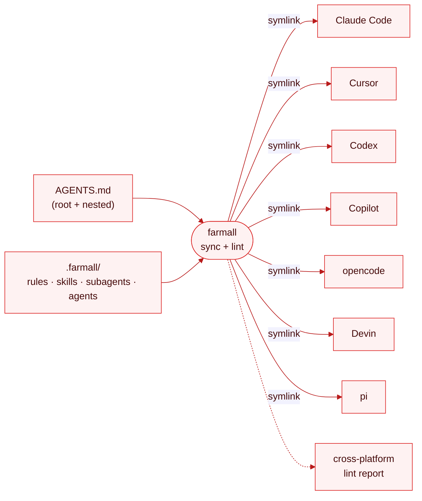

# Overview

`farmall` has one job: keep **one source of truth** for your agent config, project it out to **every**
agent you use, and lint it so it behaves the same everywhere.

> **WIP.** This page describes the design. The commands aren't wired up yet — see [Quick Start](../getting-started/quick-start.md).

## The model

You write each artifact once — instructions as `AGENTS.md` in the tree, everything else under one
[source directory](./define-once.md). `farmall sync` projects each into its agents' expected
locations — by **symlink**, not copy, so there's exactly one physical file to edit. `farmall lint`
then tells you whether that one file actually behaves on every agent it's linked into.

## The two halves

| Half     | Command        | What it does                                                    |
| -------- | -------------- | --------------------------------------------------------------- |
| **Sync** | `farmall sync` | Projects the source of truth into each agent's config location. |
| **Lint** | `farmall lint` | Checks whether the projected config behaves on each target.     |

Sync is the commodity — plenty of tools copy files around. Lint is the reason `farmall` exists.

## What it syncs

Five [targets](./targets.md), each with its own source directory:

| Target           | What it is                                                  |
| ---------------- | ----------------------------------------------------------- |
| **instructions** | portable project memory — authored once as `AGENTS.md`      |
| **rules**        | scoped rule files with frontmatter/glob activation          |
| **skills**       | reusable agent skills (`SKILL.md` and friends)              |
| **subagents**    | subagent definitions                                        |
| **agents**       | agent-level config written to each tool's expected location |

## Where it comes from

`farmall` stands on [`@sentry/dotagents-lib`](https://github.com/getsentry/dotagents) for the
commodity plumbing — skill loading, source resolution, the git cache, and trust validation. That
library is grammar-agnostic: it knows source strings, `SKILL.md`, and the cache, not a manifest
format. `farmall` layers its own [`farmall.config.ts`](./configuration.md) grammar on top and spends
its effort on the parts nobody else does well — **lint**, **instructions/rules sync**, and `pull`.

## References

- [Define Once](./define-once.md)
- [Targets](./targets.md)
- [Sync](./sync.md)
- [Lint](./lint.md)
- [Platforms](./platforms.md)
