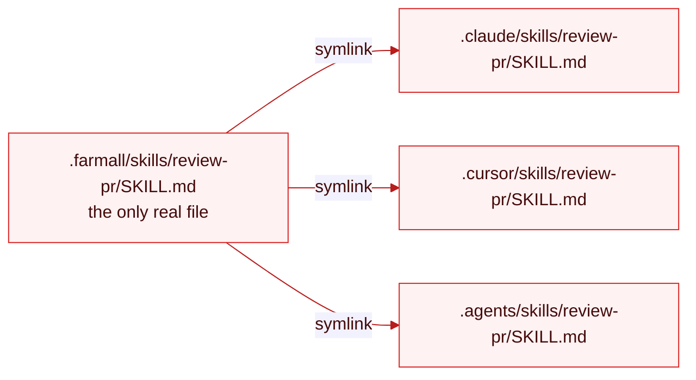
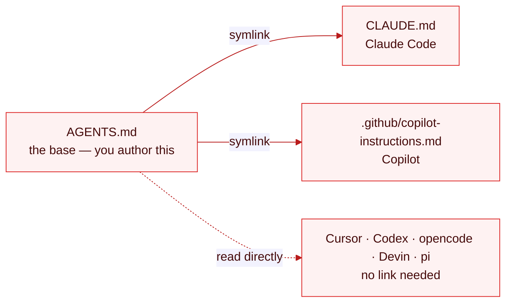

# Sync

`farmall sync` projects your source of truth into each agent's expected location. It's the half of
`farmall` everyone else also does — done here by symlink, so there's never a second copy to drift.

> **WIP.** This page describes the design. `sync` isn't wired up yet.

## Symlink, not copy

For every target file and every platform, `farmall` creates a symlink from the agent's expected path
back to the one physical file in `.farmall/`.



This is the distribution model inherited from [dotagents](https://github.com/getsentry/dotagents):
one source of truth, many links. Edit the source and every agent sees it immediately — there is
nothing to re-sync after an edit, only after you add or remove artifacts and platforms.

## The frontmatter bet

Because there's one physical file, every runtime reads the _same_ frontmatter. The bet: each agent
**drops the keys it doesn't understand** and honors the ones it does. Most do. When one doesn't — it
chokes on a foreign key, or silently ignores one you depend on — that's not a sync failure, it's a
_behavior_ failure. Catching it is [lint's](./lint.md) job, not sync's.

## Instructions: link across formats, in place

Instructions live as `AGENTS.md` in the working tree — root, and nested at any level. They're plain
markdown under different names, so the projection is a symlink written **next to** each `AGENTS.md`,
never pulled into the source directory:



Nested instructions project at their own level — `packages/api/AGENTS.md` →
`packages/api/CLAUDE.md`.

## Running it

```bash
farmall sync                 # sync every enabled target to every platform
farmall sync skills          # sync a single target
farmall sync rules --platform cursor
```

Sync is idempotent: running it again converges the link tree to match config and the source, adding
missing links and pruning ones for targets or platforms you've turned off. It never writes into the
source directory.

## Sync vs check vs diff

| Command         | Writes? | Answers                                          |
| --------------- | ------- | ------------------------------------------------ |
| `farmall sync`  | yes     | Make the links match the source and config.      |
| `farmall check` | no      | What _would_ sync change, and what's broken?     |
| `farmall diff`  | no      | Where has an agent's config drifted from source? |

See [Check and Diff](../guides/check-and-diff.md).

## References

- [Define Once](./define-once.md)
- [Lint](./lint.md)
- [CLI Reference](../reference/cli.md)
- [Support Matrix](../reference/support-matrix.md)
