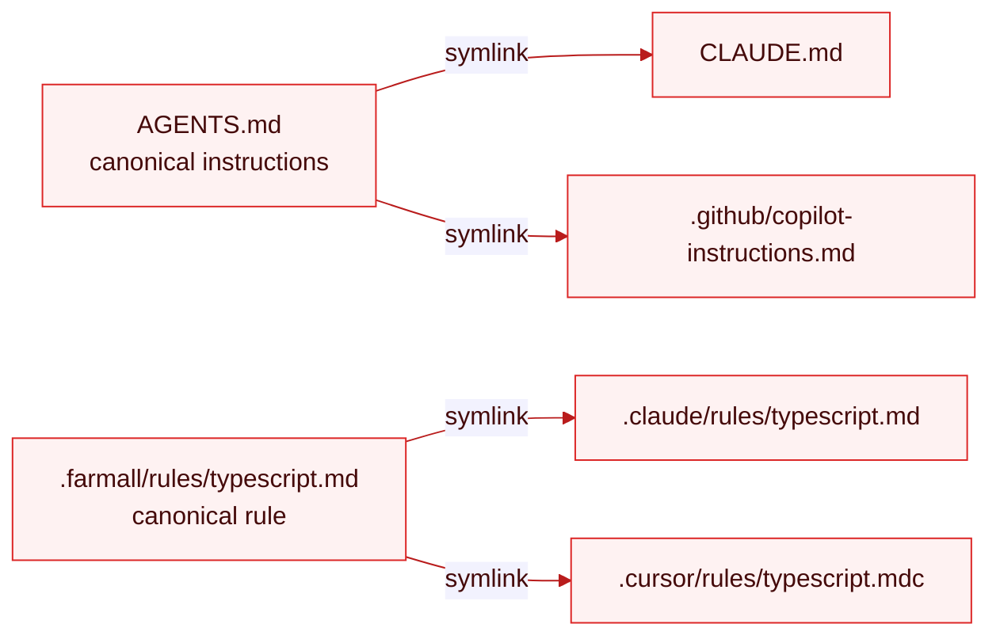

# Adopt farmall into a Repo

Take a repo with agent config already scattered across `.claude/`, `.cursor/`, and a stray `AGENTS.md`, and consolidate it into one source of truth.

> **WIP.** This page describes the design. `init` and `pull` aren't wired up yet.

## Before

A repo that grew agent config organically has copies everywhere, each edited independently and already drifting:

```
your-repo/
  AGENTS.md                        hand-written, mostly current
  CLAUDE.md                        an older fork of the same instructions
  .claude/
    rules/typescript.md
    skills/review-pr/SKILL.md
  .cursor/
    rules/typescript.mdc           same rule, Cursor frontmatter
    skills/review-pr/SKILL.md      a copy of the Claude one
  .github/
    copilot-instructions.md        yet another instructions fork
```

Three copies of your instructions, two copies of the review-pr skill, and a rule maintained twice. Nothing links; everything drifts.

## Step 1 — scaffold the source of truth

```bash
farmall init --platforms claude-code,cursor,copilot
```

`init` creates an empty `.farmall/` tree and a `farmall.config.ts` seeded with the platforms you named. It does not touch your existing config — importing that is `pull`'s job.

## Step 2 — pull existing config in

```bash
farmall pull --dry-run     # inspect first
farmall pull
```

`pull` reads what each configured platform already has on disk and consolidates it. Instructions collapse to a single canonical `AGENTS.md` in the working tree (root, and nested where they already exist) — it picks the least-lossy fork, e.g. `AGENTS.md` over an older `CLAUDE.md`. Every other target — rules, skills, subagents, agents — moves under `source` (`.farmall/` by default), de-duplicating copies that are the same artifact under different names.

Scope it to one platform when you only trust one source:

```bash
farmall pull skills --platform claude-code
```

## After

```
your-repo/
  AGENTS.md                        one canonical instructions file, in the tree
  .farmall/
    rules/typescript.md            one rule, portable markdown
    skills/review-pr/SKILL.md      one skill directory
  farmall.config.ts
```

The scattered copies are gone from the source's perspective — the next [`sync`](../concepts/sync.md) replaces them with symlinks back to the canonical file:

```bash
farmall sync
```



(Cursor, Codex, opencode, Devin, and pi read `AGENTS.md` directly, so there's no link to write for them.)

From here you edit one file and every agent sees the change. Run [`farmall check`](./check-and-diff.md) before committing to confirm the link tree matches config, and [`farmall lint`](./write-a-portable-skill.md) to catch anything that won't behave across the platforms you pulled from.

## References

- [Define Once](../concepts/define-once.md)
- [Sync](../concepts/sync.md)
- [CLI Reference](../reference/cli.md)
- [Check and Diff](./check-and-diff.md)
