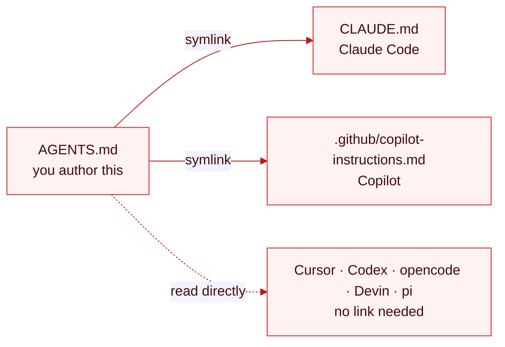
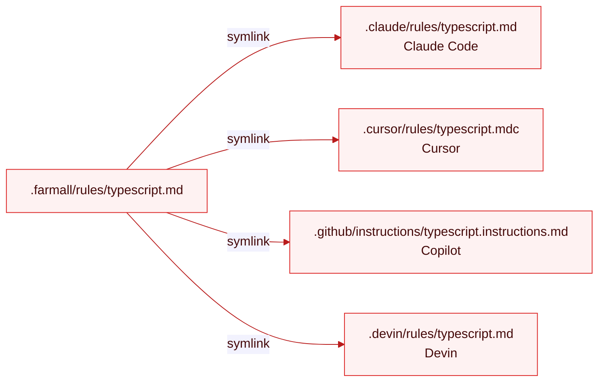

# Sync Instructions and Rules

Instructions and rules are two different targets. Author your always-on memory once as `AGENTS.md`; author scoped rules separately. `farmall` lands each in the right place per agent.

> **WIP.** This page describes the design. `sync` isn't wired up yet.

## They are not the same thing

The distinction people miss: **instructions and rules are separate targets**, and nearly every agent now supports both — separately.

|                      | instructions              | rules                      |
| -------------------- | ------------------------- | -------------------------- |
| **Cardinality**      | one per level (nestable)  | many files                 |
| **Activation**       | always loaded             | frontmatter/glob-scoped    |
| **Canonical format** | `AGENTS.md`, always       | agent-specific frontmatter |
| **Source**           | `AGENTS.md` (root+nested) | `<source>/rules/*.md`      |

**Instructions** are the always-on project memory — one document read at the start of every session. **Rules** are scoped files with frontmatter that decides _when_ they apply: glob-attached to paths, model-requested on demand, or manually invoked.

## Author instructions as AGENTS.md — the base, always

`AGENTS.md` is the default instruction format, always. It's the open standard nearly every agent reads natively, so it's the least-lossy thing to author against. It lives in the working tree — at the repo root, and nested wherever you want directory-scoped memory. It is never moved into the source directory:

```
AGENTS.md                   root instructions
packages/api/AGENTS.md      scoped to packages/api
```

`farmall sync instructions` projects each `AGENTS.md` to the other agents' filenames **next to it** — never the reverse:



Same content, different filename. The CLAUDE.md your Claude Code picks up is a link to the `AGENTS.md` beside it. A nested `packages/api/AGENTS.md` projects to `packages/api/CLAUDE.md`.

Instructions land here per platform ([support matrix](../reference/support-matrix.md#instructions)):

| Platform    | Location                          |
| ----------- | --------------------------------- |
| claude-code | `CLAUDE.md`                       |
| cursor      | `AGENTS.md`                       |
| codex       | `AGENTS.md`                       |
| copilot     | `.github/copilot-instructions.md` |
| opencode    | `AGENTS.md`                       |
| devin       | `AGENTS.md`                       |
| pi          | `AGENTS.md`                       |

## Author rules as scoped files

Rules live under `.farmall/rules/*.md`, one file per concern, each with the frontmatter that scopes it:

```markdown
---
description: TypeScript conventions for this repo
globs: "**/*.ts"
---

Prefer factory functions over classes. Never mutate arguments...
```

`farmall sync rules` projects each file to the agents that have a rules system:



Rules land — or don't — per platform ([support matrix](../reference/support-matrix.md#rules)):

| Platform    | Location                                 |
| ----------- | ---------------------------------------- |
| claude-code | `.claude/rules/*.md`                     |
| cursor      | `.cursor/rules/*.mdc`                    |
| codex       | —                                        |
| copilot     | `.github/instructions/*.instructions.md` |
| opencode    | partial                                  |
| devin       | `.devin/rules/*.md`                      |
| pi          | —                                        |

Codex and pi have no rules system — those dashes are where a rule you wrote can't land. That's not hidden; the [`portability`](../reference/lint-rules.md#portability) rule flags it. Because sync links one physical file, every runtime reads the _same_ rule frontmatter — Cursor's `.mdc` may expect a trigger field Claude Code drops. Catching that divergence is [lint's](../concepts/lint.md) job.

## Run it

```bash
farmall sync instructions
farmall sync rules
farmall sync rules --platform cursor
```

## References

- [Targets](../concepts/targets.md)
- [Sync](../concepts/sync.md)
- [Support Matrix](../reference/support-matrix.md)
- [Write a Portable Skill](./write-a-portable-skill.md)
