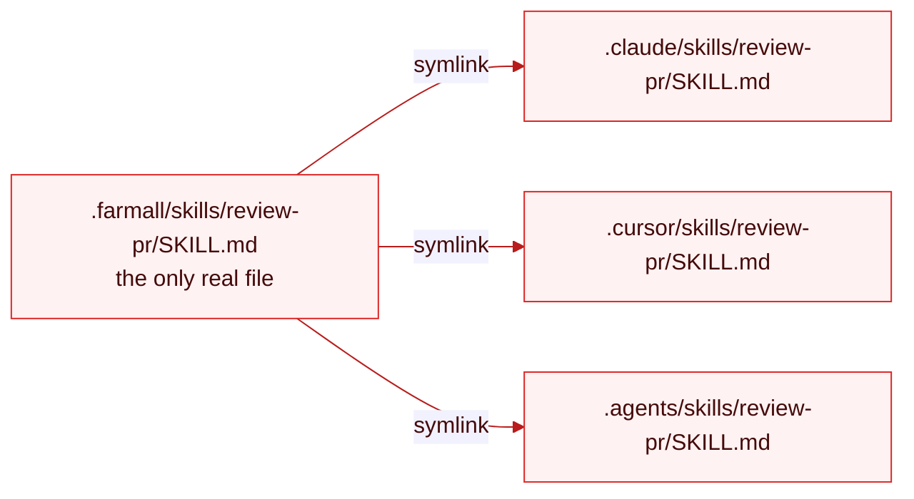

# Sync Skills

Author a skill once under `.farmall/skills/<name>/SKILL.md` and project it to every agent's skills location by symlink.

> **WIP.** This page describes the design. `sync` isn't wired up yet.

## Author the skill

A [skill](../concepts/targets.md#skills) is a directory with a `SKILL.md` and optional supporting files, following the [Agent Skills open standard](https://agentskills.io):

```
.farmall/skills/review-pr/
  SKILL.md
  references/
    checklist.md
  scripts/
    diff.sh
```

`SKILL.md` carries the name, description, and instructions in frontmatter plus body:

```markdown
---
name: review-pr
description: Review a pull request diff for correctness and house-style issues. Use when the user asks for a code review or PR feedback.
---

Read the diff, then check each hunk against `references/checklist.md`...
```

## Sync it

```bash
farmall sync skills
```

`sync` creates one symlink per configured platform, each pointing back at the single physical directory in `.farmall/`:



There's exactly one file to edit. Change `SKILL.md` and every agent reads the change immediately — there's nothing to re-sync until you add or remove a skill or a platform.

## Where skills land per platform

Skills go to different paths depending on the agent (see the [support matrix](../reference/support-matrix.md#skills)):

| Platform    | Location                 |
| ----------- | ------------------------ |
| claude-code | `.claude/skills/<name>/` |
| cursor      | `.cursor/skills/<name>/` |
| codex       | `.agents/skills/<name>/` |
| copilot     | `.github/skills/<name>/` |
| opencode    | partial                  |
| devin       | `.agents/skills/<name>/` |
| pi          | `.agents/skills/<name>/` |

## The `.agents/` shortcut

Codex and Cursor read `.agents/skills/` natively. If you set [`source`](../concepts/configuration.md) to `.agents`, your skills already live where those two agents look:

```ts
export default defineConfig({
  source: ".agents",
  platforms: ["codex", "cursor", "claude-code"],
});
```

With `source: ".agents"`, `farmall sync skills` writes no extra links for codex or cursor — the source directory _is_ their skills location. Claude Code still gets its `.claude/skills/` symlinks back to the same files.

## Scope which skills sync

Filter with `include` / `exclude` globs in the [sync spec](../concepts/configuration.md#per-target-sync-spec):

```ts
sync: {
  skills: { include: "skills/**", exclude: "**/*.wip/**" },
}
```

Run [`farmall lint skills`](./write-a-portable-skill.md) afterward: one physical `SKILL.md` is read by every runtime, and lint tells you whether its description will actually fire on each one.

## References

- [Targets](../concepts/targets.md)
- [Sync](../concepts/sync.md)
- [Support Matrix](../reference/support-matrix.md)
- [Write a Portable Skill](./write-a-portable-skill.md)
